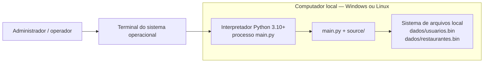

# Arquitetura Física

## Implantação atual

O sistema atual não é distribuído: `main.py`, aplicação, domínio e
infraestrutura rodam em um único processo Python na máquina que executa o
comando. Não há servidor web, banco de dados ou serviço externo integrado no
fluxo executável atual.

## Componentes executáveis e dados

| Elemento | Localização/tecnologia | Papel físico |
|---|---|---|
| Processo da aplicação | `python main.py` | Executa CLI, fachada, regras e persistência no mesmo processo. |
| Código | `main.py` e diretório `source/` | Módulos Python empacotados no repositório; usa biblioteca padrão. |
| Persistência em memória | Processo Python | Mantém os registros apenas durante a execução. |
| Persistência em arquivo | `dados/usuarios.bin` e `dados/restaurantes.bin` | Arquivos binários locais, separados por entidade. São carregados no início e regravados durante as operações. |
| Testes | Diretório `tests/` | Executados com `python -m pytest`; `pytest` é dependência de desenvolvimento, não requisito para executar o sistema. |

O armazenamento padrão é memória. Com `--armazenamento arquivo`, os arquivos
padrão são `dados/usuarios.bin` e `dados/restaurantes.bin`; `--caminho` e
`--caminho-restaurantes` permitem definir caminhos próprios. O processo precisa
de permissão de leitura e gravação no diretório escolhido.

Os repositórios em arquivo gravam primeiro em um arquivo temporário e usam
substituição atômica do arquivo de destino. Falhas são convertidas em
`ErroPersistenciaBase`; na inicialização e nas operações do CLI, a aplicação
apresenta a falha sem expor traceback. Os arquivos usam `pickle` e devem ser
tratados como dados confiáveis gerados pela própria aplicação, não como entrada
de terceiros.

## Limites de implantação

- A seleção de persistência é local à inicialização; não há serviço de banco
  remoto nem coordenação entre processos.
- O Singleton garante uma fachada por processo. Ele não fornece sincronização
  de escrita entre processos ou máquinas.
- O Gateway de Pagamento, embora apareça na visão do produto e nos casos de
  uso futuros, não faz parte da topologia executável atual.
- A aplicação web prevista em [01-visao.md](../01-visao.md) ainda não foi
  implantada. Os wireframes em [06-interface](../06-interface/README.md)
  descrevem telas conceituais, não páginas disponíveis.
