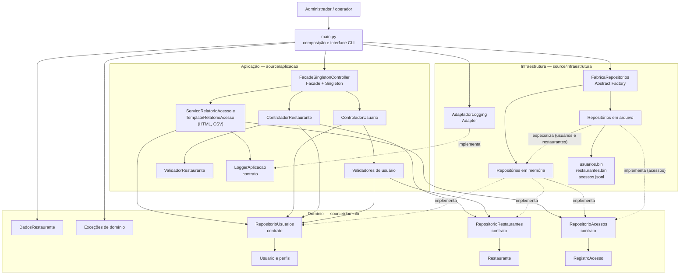

# Arquitetura Lógica

## Estilo e limites

O sistema atual é um **monólito modular em camadas**. Os módulos são executados
no mesmo processo Python; a separação por pacotes estabelece os limites
lógicos. O fluxo de produção parte de `main.py`, que escolhe a persistência,
obtém a fachada e usa suas operações. A interface atual é CLI; não há ainda
fronteira web implementada.

## Responsabilidades e dependências

| Módulo/camada | Responsabilidades | Dependências permitidas |
|---|---|---|
| `main.py` | Ler opções de execução, escolher a fábrica concreta de repositórios, criar o Adapter de logging, obter a fachada, construir dados de domínio usados no fluxo CLI e tratar exceções de domínio. | Aplicação, domínio e infraestrutura. |
| Aplicação | Validar e coordenar casos de uso; a fachada constrói os controladores e o serviço de relatórios de acesso e os expõe; controladores aplicam regras de aplicação; define o contrato de logging. | Contratos e entidades do domínio. |
| Domínio | Definir `Usuario`, perfis, `Restaurante`, `RegistroAcesso`, dados de domínio, exceções e contratos de repositório. | Biblioteca padrão e outros elementos do domínio. |
| Infraestrutura | Implementar repositórios em memória e em arquivo, as fábricas de repositórios e o Adapter de logging. | Contratos e entidades do domínio; contrato de logging da aplicação. |

A camada de aplicação conhece os contratos de repositório e de logging, não as
classes concretas de persistência nem a biblioteca `logging`. Os repositórios
concretos são criados pelas fábricas de
`source/infraestrutura/persistencia/fabrica_repositorios.py`
([ADR-0009](./adr/0009-repository-e-factory-para-entidades-persistidas.md)), e
a escolha entre `FabricaRepositoriosMemoria` e `FabricaRepositoriosArquivo`
fica em um único ponto do `main.py`, `escolher_fabrica`. A fachada recebe os
repositórios de usuários, restaurantes e acessos e o logger na primeira
chamada de `obter_instancia`; chamadas posteriores reutilizam a mesma instância
e não podem substituí-los silenciosamente.

## Fluxo de cadastro de restaurante

1. `main.py` solicita `RepositorioUsuarios`, `RepositorioRestaurantes` e
   `RepositorioAcessos` à fábrica concreta e os entrega, com o logger, a
   `FacadeSingletonController.obter_instancia`.
2. A fachada encaminha `cadastrar_restaurante` ao `ControladorRestaurante`.
3. O controlador valida e normaliza `DadosRestaurante`, cria a entidade e pede
   ao contrato `RepositorioRestaurantes` para persistir.
4. O repositório concreto atribui o ID; quando configurado para arquivo,
   persiste os dados antes de retornar sucesso.

## Fluxo do CRUD de usuários

- **Consulta:** a fachada encaminha `buscar_usuario(id)` ao controlador, que
  delega `buscar_por_id(id)` ao contrato `RepositorioUsuarios`. Um ID ausente
  é informado como usuário não encontrado.
- **Atualização:** o controlador localiza o usuário, valida os dados com
  `id_ignorado` para excluir o próprio registro das verificações de unicidade,
  aplica os campos editáveis e delega a gravação ao repositório. O ID, o
  perfil e os dados específicos do perfil permanecem inalterados.
- **Remoção:** o controlador confirma a existência do ID antes de solicitar
  `remover(id)` ao repositório. No armazenamento em arquivo, a alteração é
  gravada antes de a operação ser considerada concluída.

As implementações em arquivo usam gravação atômica. O rollback da atualização
de usuário quando a gravação falha ainda requer correção; a garantia esperada
de preservação do estado anterior está especificada em
[NF-CON-01](../../openspec/specs/rnf/confiabilidade/spec.md).

## Contagem consolidada

`RepositorioUsuarios` e `RepositorioRestaurantes` expõem `contar()`. Os
controladores delegam a contagem; a fachada fornece a contagem por tipo e
`contar_total_entidades()`, que soma usuários e restaurantes; os registros de
acesso não entram nessa contagem. O diagrama de classes está em
[08-projeto.md](../08-projeto.md), e a decisão do padrão está registrada no
[ADR-0008](./adr/0008-fachada-singleton-dos-controladores.md).

## Fluxo do relatório de acessos

1. `main.py` chama `gerar_relatorio_acessos(formato)` na fachada, que delega ao
   `ServicoRelatorioAcesso`.
2. O serviço normaliza o formato; se não for HTML nem CSV, registra um aviso no
   logger e lança `FormatoRelatorioInvalido`.
3. O serviço instancia `RelatorioAcessoHTML` ou `RelatorioAcessoCSV`, que lê os
   registros em `RepositorioAcessos`, consulta login e perfil em
   `RepositorioUsuarios`, calcula as estatísticas e formata o `Documento`.
4. O serviço registra no logger o resultado, ou a falha de persistência como
   erro, e devolve o documento.

Nenhum fluxo do sistema cria registros de acesso: a captura não está
implementada, e em execução normal o relatório sai com totais zero. O detalhe
está em [08-projeto.md](../08-projeto.md) e nas
[ADR-0010](./adr/0010-adapter-para-logging.md) e
[ADR-0011](./adr/0011-template-method-para-relatorios-de-acesso.md).
