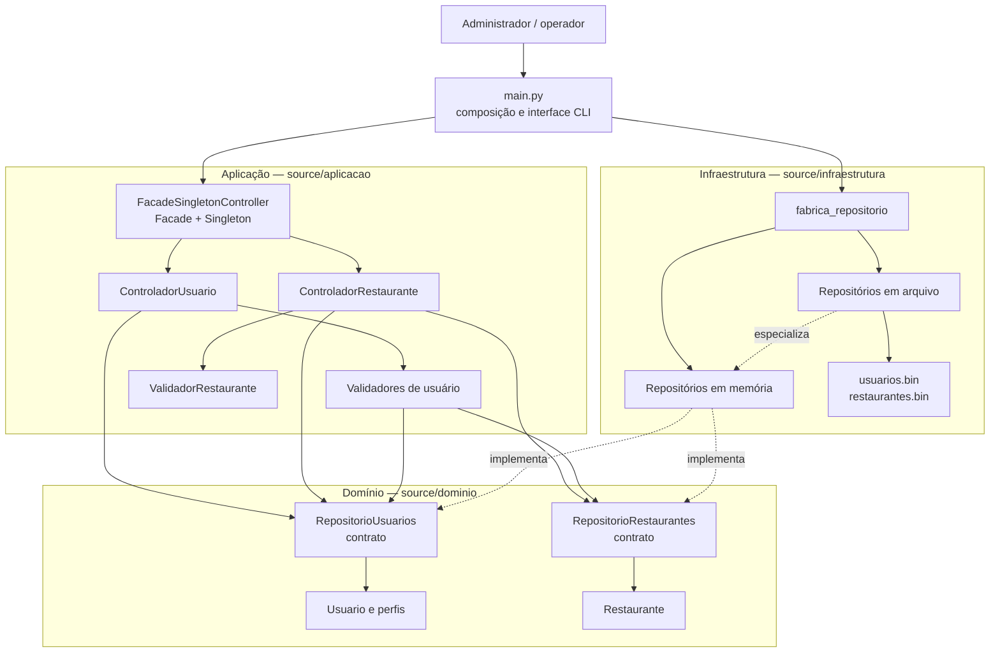

# Arquitetura Lógica

## Estilo e limites

O sistema atual é um **monólito modular em camadas**. Os módulos são executados
no mesmo processo Python; a separação por pacotes estabelece os limites
lógicos. O fluxo de produção parte de `main.py`, que escolhe a persistência,
obtém a fachada e usa suas operações. A interface atual é CLI; não há ainda
fronteira web implementada.

## Responsabilidades e dependências

| Módulo/camada | Responsabilidades | Dependências permitidas |
|---|---|---|
| `main.py` | Ler opções de execução, selecionar repositórios na fábrica, obter a fachada e apresentar o fluxo CLI. | Aplicação e infraestrutura. |
| Aplicação | Validar e coordenar casos de uso; a fachada constrói os controladores e os expõe; controladores aplicam regras de aplicação. | Contratos e entidades do domínio. |
| Domínio | Definir `Usuario`, perfis, `Restaurante`, dados de domínio, exceções e contratos de repositório. | Biblioteca padrão e outros elementos do domínio. |
| Infraestrutura | Implementar repositórios em memória e arquivo binário e selecionar implementação pela fábrica. | Contratos e entidades do domínio. |

A camada de aplicação conhece os contratos de repositório, não as classes
concretas de persistência. A escolha de memória ou arquivo fica centralizada em
`source/infraestrutura/persistencia/fabrica_repositorio.py`. A fachada recebe
os repositórios na primeira chamada de `obter_instancia`; chamadas posteriores
reutilizam a mesma instância e não podem substituir silenciosamente os
repositórios.

## Fluxo de cadastro de restaurante

1. `main.py` solicita `RepositorioRestaurantes` e `RepositorioUsuarios` à
   fábrica e entrega ambos a `FacadeSingletonController.obter_instancia`.
2. A fachada encaminha `cadastrar_restaurante` ao `ControladorRestaurante`.
3. O controlador valida e normaliza `DadosRestaurante`, cria a entidade e pede
   ao contrato `RepositorioRestaurantes` para persistir.
4. O repositório concreto atribui o ID; quando configurado para arquivo,
   persiste os dados antes de retornar sucesso.

## Contagem consolidada

`RepositorioUsuarios` e `RepositorioRestaurantes` expõem `contar()`. Os
controladores delegam a contagem; a fachada fornece a contagem por tipo e
`contar_total_entidades()`, que soma usuários e restaurantes. O diagrama de
classes está em [08-projeto.md](../08-projeto.md), e a decisão do padrão está
registrada no [ADR-0008](./adr/0008-fachada-singleton-dos-controladores.md).
