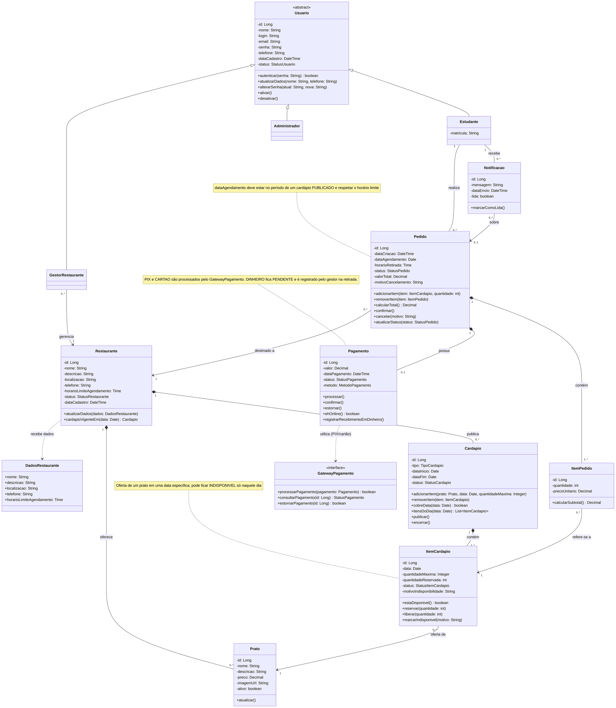
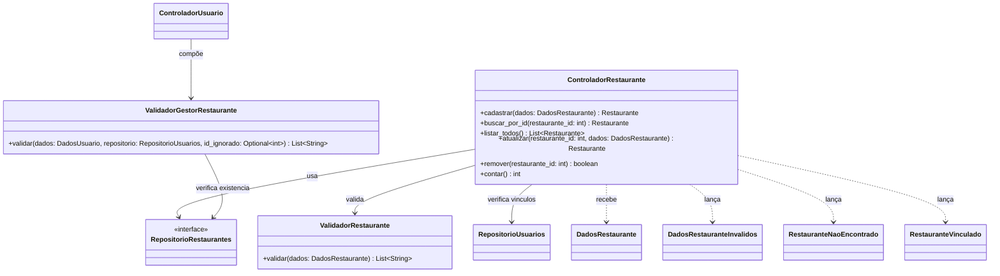
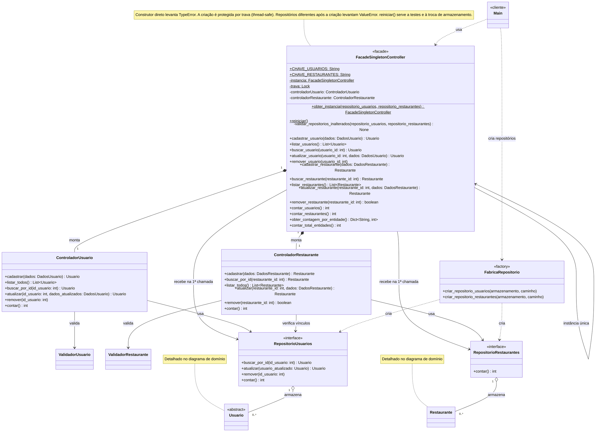
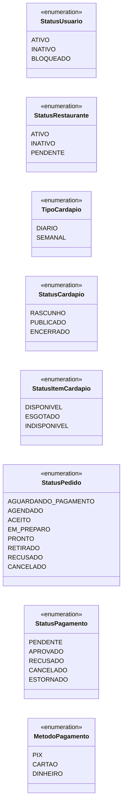
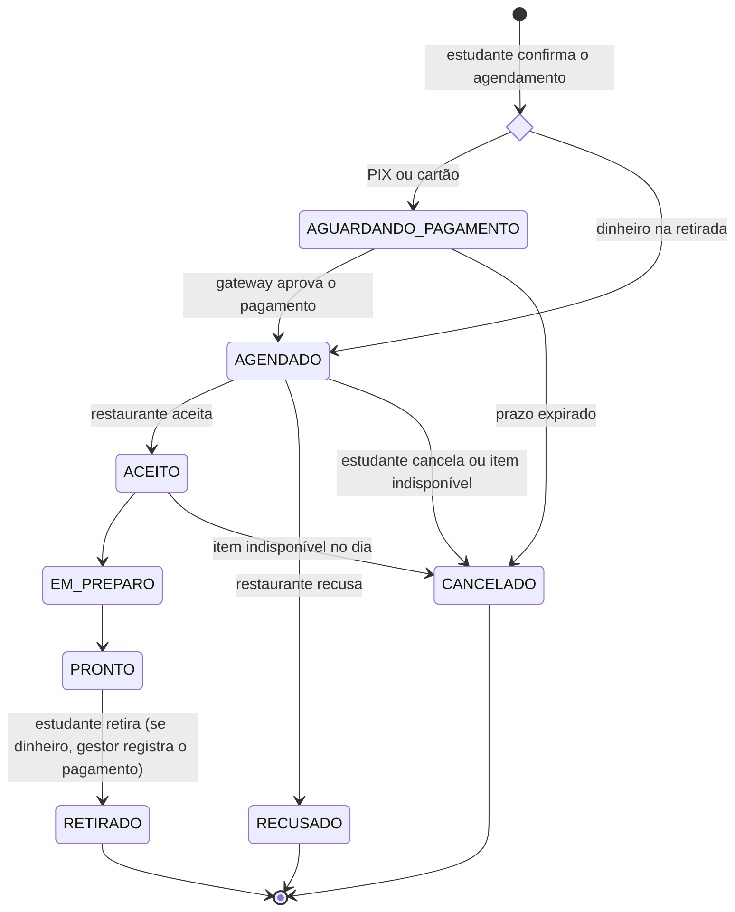

# Documento do Projeto — Versão 3

Esta versão consolida o modelo do domínio e as revisões do projeto até a
Sprint 4. Além do diagrama de classes de domínio, contempla a análise e o
projeto do CRUD de usuários e restaurantes, a fachada Singleton, a persistência
e a separação de camadas com Repository e uma fábrica simples de repositórios.
Também apresenta, como **planejados** e ainda não implementados, o registro de
acesso e os relatórios de acesso em HTML e CSV, com o Template Method para a
geração dos relatórios, o Adapter de logging e a hierarquia Abstract Factory
que substituirá a fábrica simples.

## Diagrama de Classes de Domínio

Este diagrama mostra as entidades do sistema, com seus atributos, operações e relacionamentos. Ele organiza o domínio em quatro partes:

- **Usuários:** `Usuario` é uma classe abstrata, identificada por um `login`, e especializada em `Estudante`, `GestorRestaurante` e `Administrador`. Cada gestor está vinculado ao restaurante que administra.
- **Restaurante e cardápio:** o restaurante mantém seu catálogo de `Prato`s e publica `Cardapio`s **diários** ou **semanais**. Cada `ItemCardapio` representa a oferta de um prato em **uma data específica**, com status próprio. Por isso um prato pode ficar indisponível apenas naquele dia.
- **Pedidos:** o `Pedido` é feito por um estudante para uma data e um restaurante. Seus itens apontam para as ofertas do dia (`ItemCardapio`), e não diretamente para o prato. Isso garante que só se agenda o que foi publicado para aquela data.
- **Pagamento e notificação:** pagamentos via PIX ou cartão passam pelo `GatewayPagamento`, e pagamentos em dinheiro são registrados na retirada. As `Notificacao`s avisam o estudante sobre mudanças no pedido, como o cancelamento por indisponibilidade.

Em seguida, a seção **Cadastro de usuários** detalha as classes de aplicação, domínio e infraestrutura que implementam o cadastro (Laboratório 2): a validação de login e senha por exceções e a persistência dos usuários em memória ou em arquivo binário.

Ao final estão as enumerações, o ciclo de vida do pedido e as formas de pagamento aceitas.

## Diagrama de Classes de Projeto — Camadas Business e Infra (S4.1)

O diagrama a seguir detalha a separação entre a camada business (aplicação e
domínio) e a infraestrutura para as entidades já persistidas no código:
usuários e restaurantes. Também mostra, como **planejados**, o registro de
acesso, seu repositório, a hierarquia Abstract Factory de repositórios, o
Adapter de logging e a geração de relatórios definidos para a Sprint 4. Os
demais elementos do diagrama de domínio acima continuam conceituais e ainda não
têm persistência implementada neste projeto.

Cada classe do diagrama traz uma única anotação, que termina sempre com a
situação do elemento; quando há um papel (`interface`, `abstract`, `Adapter`,
`Abstract Factory`, `fábrica simples` etc.), ele vem antes, separado por
vírgula. As situações são:

- `implementado`: presente no código.
- `planejado`: elemento de desenho que ainda precisa ser implementado.
- `parcial`: usado só em `FacadeSingletonController`; a classe está
  implementada, mas `gerar_relatorio_acessos`, os parâmetros
  `repositorio_acessos` e `logger` de `obter_instancia` e a montagem do
  serviço de relatórios são planejados.
- `externo`: módulo `logging` da biblioteca padrão do Python, que existe fora
  do projeto e ainda não é usado pelo código.

Relações que envolvem ao menos um elemento planejado também são planejadas. Os
contratos Repository ficam no domínio, enquanto as implementações concretas e
as fábricas ficam na infraestrutura. Hoje a escolha do repositório é feita por
uma fábrica simples: as funções `criar_repositorio_usuarios` e
`criar_repositorio_restaurantes` de `fabrica_repositorio.py`, representadas
como `FabricaRepositorio`, decidem por um `if` sobre `armazenamento`. Essa
fábrica simples não é um Factory Method nem um Abstract Factory; a hierarquia
`FabricaRepositorios`, que a substituirá, é planejada. Neste recorte, as classes
`Prato`, `Cardapio`, `ItemCardapio`, `Pedido`, `ItemPedido`, `Pagamento` e
`Notificacao` do diagrama de domínio continuam conceituais; seus repositórios
não são apresentados como implementados.

```mermaid
%%{init: {"flowchart": {"useMaxWidth": false}, "class": {"useMaxWidth": false}, "sequence": {"useMaxWidth": false}, "state": {"useMaxWidth": false}}}%%
classDiagram
    direction TB

    class Main {
        <<cliente, implementado>>
    }

    namespace BusinessAplicacao {
        class FacadeSingletonController {
            <<facade, parcial>>
            +obter_instancia(repositorio_usuarios, repositorio_restaurantes, repositorio_acessos, logger) FacadeSingletonController$
            +gerar_relatorio_acessos(formato: String) Documento
        }
        class ControladorUsuario {
            <<implementado>>
        }
        class ControladorRestaurante {
            <<implementado>>
        }
        class ServicoRelatorioAcesso {
            <<planejado>>
            -repositorio_acessos: RepositorioAcessos
            -repositorio_usuarios: RepositorioUsuarios
            -logger: LoggerAplicacao
            +gerar(formato: String) Documento
        }
        class FormatoRelatorioInvalido {
            <<exceção, planejado>>
            +formatos_aceitos: List~String~
        }
        class TemplateRelatorioAcesso {
            <<abstract, planejado>>
            -repositorio_acessos: RepositorioAcessos
            -repositorio_usuarios: RepositorioUsuarios
            +gerar() Documento
            #obter_estatisticas() EstatisticasAcesso
            #formatar(estatisticas: EstatisticasAcesso) Documento
        }
        class RelatorioAcessoHTML {
            <<planejado>>
            #formatar(estatisticas: EstatisticasAcesso) Documento
        }
        class RelatorioAcessoCSV {
            <<planejado>>
            #formatar(estatisticas: EstatisticasAcesso) Documento
        }
        class EstatisticasAcesso {
            <<valor, planejado>>
            +total_acessos: int
            +usuarios_distintos: int
            +detalhamento: List~AcessosPorUsuario~
        }
        class AcessosPorUsuario {
            <<valor, planejado>>
            +usuario_id: int
            +login: String
            +perfil: String
            +quantidade: int
        }
        class Documento {
            <<valor, planejado>>
            +formato: String
            +conteudo: String
        }
        class LoggerAplicacao {
            <<interface, planejado>>
            +registrar(evento: String, detalhes: String)
        }
    }

    namespace BusinessDominio {
        class Usuario {
            <<abstract, implementado>>
        }
        class Estudante {
            <<implementado>>
        }
        class GestorRestaurante {
            <<implementado>>
        }
        class Administrador {
            <<implementado>>
        }
        class Restaurante {
            <<implementado>>
        }
        class RegistroAcesso {
            <<planejado>>
            +usuario_id: int
            +instante: DateTime
        }
        class RepositorioUsuarios {
            <<interface, implementado>>
            +buscar_por_id(id_usuario: int) Optional~Usuario~
        }
        class RepositorioRestaurantes {
            <<interface, implementado>>
        }
        class RepositorioAcessos {
            <<interface, planejado>>
            +registrar(acesso: RegistroAcesso)
            +listar_todos() List~RegistroAcesso~
        }
    }

    namespace Infraestrutura {
        class FabricaRepositorio {
            <<módulo de funções, fábrica simples, implementado>>
            +criar_repositorio_usuarios(armazenamento: String, caminho: Optional~Path~) RepositorioUsuarios$
            +criar_repositorio_restaurantes(armazenamento: String, caminho: Optional~Path~) RepositorioRestaurantes$
        }
        class FabricaRepositorios {
            <<Abstract Factory, planejado>>
            +criar_repositorio_usuarios() RepositorioUsuarios*
            +criar_repositorio_restaurantes() RepositorioRestaurantes*
            +criar_repositorio_acessos() RepositorioAcessos*
        }
        class FabricaRepositoriosMemoria {
            <<fábrica concreta, planejado>>
        }
        class FabricaRepositoriosArquivo {
            <<fábrica concreta, planejado>>
            -caminho_usuarios: Path
            -caminho_restaurantes: Path
            -caminho_acessos: Path
        }
        class RepositorioUsuariosMemoria {
            <<implementado>>
        }
        class RepositorioUsuariosArquivo {
            <<implementado>>
        }
        class RepositorioRestaurantesMemoria {
            <<implementado>>
        }
        class RepositorioRestaurantesArquivo {
            <<implementado>>
        }
        class RepositorioAcessosMemoria {
            <<planejado>>
        }
        class RepositorioAcessosArquivo {
            <<planejado>>
            -caminho: Path
        }
        class AdaptadorLogging {
            <<Adapter, planejado>>
            +registrar(evento: String, detalhes: String)
        }
        class BibliotecaLogging {
            <<externo>>
        }
    }

    Main ..> FabricaRepositorio : chama (hoje)
    Main ..> FabricaRepositorios : escolhe a concreta
    Main ..> AdaptadorLogging : cria (planejado)
    Main ..> FacadeSingletonController : entrega repositórios

    FacadeSingletonController *-- ControladorUsuario : monta
    FacadeSingletonController *-- ControladorRestaurante : monta
    FacadeSingletonController *-- ServicoRelatorioAcesso : monta e delega
    ControladorUsuario --> RepositorioUsuarios : usa
    ControladorRestaurante --> RepositorioRestaurantes : usa

    RepositorioUsuarios <|.. RepositorioUsuariosMemoria
    RepositorioUsuariosMemoria <|-- RepositorioUsuariosArquivo
    RepositorioRestaurantes <|.. RepositorioRestaurantesMemoria
    RepositorioRestaurantesMemoria <|-- RepositorioRestaurantesArquivo
    RepositorioAcessos <|.. RepositorioAcessosMemoria
    RepositorioAcessos <|.. RepositorioAcessosArquivo

    RepositorioUsuariosMemoria o-- Usuario : armazena
    RepositorioRestaurantesMemoria o-- Restaurante : armazena
    RepositorioAcessosMemoria o-- RegistroAcesso : armazena
    RepositorioAcessosArquivo ..> RegistroAcesso : acrescenta
    RegistroAcesso --> Usuario : identifica
    Usuario <|-- Estudante
    Usuario <|-- GestorRestaurante
    Usuario <|-- Administrador

    FabricaRepositorio ..> RepositorioUsuariosMemoria : cria
    FabricaRepositorio ..> RepositorioUsuariosArquivo : cria
    FabricaRepositorio ..> RepositorioRestaurantesMemoria : cria
    FabricaRepositorio ..> RepositorioRestaurantesArquivo : cria

    FabricaRepositorios <|-- FabricaRepositoriosMemoria
    FabricaRepositorios <|-- FabricaRepositoriosArquivo
    FabricaRepositoriosMemoria ..> RepositorioUsuariosMemoria : cria
    FabricaRepositoriosMemoria ..> RepositorioRestaurantesMemoria : cria
    FabricaRepositoriosMemoria ..> RepositorioAcessosMemoria : cria
    FabricaRepositoriosArquivo ..> RepositorioUsuariosArquivo : cria
    FabricaRepositoriosArquivo ..> RepositorioRestaurantesArquivo : cria
    FabricaRepositoriosArquivo ..> RepositorioAcessosArquivo : cria

    ServicoRelatorioAcesso ..> RelatorioAcessoHTML : cria se formato = HTML
    ServicoRelatorioAcesso ..> RelatorioAcessoCSV : cria se formato = CSV
    ServicoRelatorioAcesso ..> TemplateRelatorioAcesso : chama gerar()
    ServicoRelatorioAcesso ..> FormatoRelatorioInvalido : lança
    TemplateRelatorioAcesso --> RepositorioAcessos : consulta registros
    TemplateRelatorioAcesso --> RepositorioUsuarios : consulta login e perfil
    TemplateRelatorioAcesso ..> EstatisticasAcesso : produz
    EstatisticasAcesso "1" *-- "0..*" AcessosPorUsuario : detalha
    TemplateRelatorioAcesso ..> Documento : gera
    TemplateRelatorioAcesso <|-- RelatorioAcessoHTML
    TemplateRelatorioAcesso <|-- RelatorioAcessoCSV
    ServicoRelatorioAcesso --> LoggerAplicacao : registra resultado
    LoggerAplicacao <|.. AdaptadorLogging : implementa
    AdaptadorLogging --> BibliotecaLogging : delega

    note for FabricaRepositorio "Fábrica simples atual, a ser substituída por FabricaRepositorios."
    note for FacadeSingletonController "Os membros de relatório e de logger são planejados."
    note for TemplateRelatorioAcesso "gerar() chama obter_estatisticas() e depois formatar()."
    note for RepositorioAcessosArquivo "Grava por acréscimo, por isso não herda da versão em memória."
```

**Composição e fábricas.** Hoje, a composição em `main.py` chama as funções de
`FabricaRepositorio` com `armazenamento` (`memoria` ou `arquivo`) e um
`caminho` opcional e entrega os repositórios de usuários e de restaurantes à
`FacadeSingletonController`; é por esse ponto que a escolha da infraestrutura
chega à camada business. `FabricaRepositorio` representa o módulo
`fabrica_repositorio.py`: são funções, sem classe instanciável, e cada uma
decide por um `if` sobre `armazenamento`. No desenho planejado
([ADR-0009](./07-arquitetura/adr/0009-repository-e-factory-para-entidades-persistidas.md)),
essa fábrica simples é substituída pelo Abstract Factory `FabricaRepositorios`:
a mesma composição escolhe, em um único ponto e a partir de `armazenamento`, a
fábrica concreta (`FabricaRepositoriosMemoria` ou `FabricaRepositoriosArquivo`,
esta com os caminhos dos três arquivos), obtém dela os três repositórios, cria
o `AdaptadorLogging` e entrega tudo à fachada em `obter_instancia`.

**Fachada.** Como registra a
[ADR-0008](./07-arquitetura/adr/0008-fachada-singleton-dos-controladores.md),
o `main.py` conhece apenas a fábrica e a fachada e não chama o serviço de
relatórios. A fachada já está implementada; são planejados
`gerar_relatorio_acessos(formato)`, os parâmetros `repositorio_acessos` e
`logger` de `obter_instancia` e a montagem interna do
`ServicoRelatorioAcesso`, ao qual a fachada delega o relatório.

**Registros de acesso.** Os registros de acesso são imutáveis:
`RepositorioAcessos` só registra e lista, sem atualizar nem remover; o
contrato, a entidade e as implementações ainda precisam ser implementados.
`RepositorioAcessosArquivo` difere dos repositórios em arquivo de usuários e
restaurantes, que herdam da versão em memória e regravam o arquivo binário
inteiro a cada alteração. Ele implementa o contrato diretamente e acrescenta
cada registro ao fim do arquivo, uma linha JSON por registro, sem reescrever
os anteriores: o dado só cresce e nunca é editado, e regravar tudo a cada
acesso custaria proporcionalmente ao histórico. O registro guarda só o id do
usuário, o que pressupõe que ids de usuário não são reaproveitados e que os
armazenamentos de usuários e de acessos são usados sempre em conjunto.

**Geração do relatório.** O `ServicoRelatorioAcesso` representa o ponto de
coordenação do caso de uso. Ele guarda os repositórios de acessos e de
usuários e o logger, instancia `RelatorioAcessoHTML` ou `RelatorioAcessoCSV`
conforme o formato pedido, passando os dois repositórios, chama `gerar()` e
registra o resultado no logger. Para outro formato, lança
`FormatoRelatorioInvalido`, subclasse de `ValueError` como
`DadosUsuarioInvalidos` e as demais recusas de validação dos controladores,
com uma mensagem que informa os formatos aceitos. O `TemplateRelatorioAcesso`
aplica o Template Method
([ADR-0011](./07-arquitetura/adr/0011-template-method-para-relatorios-de-acesso.md)):
`gerar()` chama `obter_estatisticas()` e depois `formatar()`. A primeira
obtém os registros em `RepositorioAcessos` e consulta em `RepositorioUsuarios`
o login e o perfil de cada usuário, exigidos pelo RF16, sem duplicar esses
dados no `RegistroAcesso`; `buscar_por_id` devolve `None` para usuário
removido. O resultado é um `EstatisticasAcesso`, com o total de acessos, a
quantidade de usuários distintos e o detalhamento em `AcessosPorUsuario`,
ordenado pela quantidade de acessos (decrescente) e, no empate, pelo id
(crescente). Os registros de um usuário removido continuam contando nos
totais; no detalhamento, a linha mostra o id e indica login e perfil como
"usuário removido". Cada formato especializa apenas `formatar`, que produz o
`Documento`, isto é, o conteúdo textual no formato pedido (HTML ou CSV).

**Logging.** O `AdaptadorLogging` implementa o contrato `LoggerAplicacao` e
delega ao módulo `logging` da biblioteca padrão do Python, representado por
`BibliotecaLogging`, sem transformar logs em fonte dos dados estatísticos. Os
detalhes dessas decisões estão nas ADRs de
[Repository e Factory](./07-arquitetura/adr/0009-repository-e-factory-para-entidades-persistidas.md),
do [Adapter de logging](./07-arquitetura/adr/0010-adapter-para-logging.md)
e do [Template Method dos relatórios](./07-arquitetura/adr/0011-template-method-para-relatorios-de-acesso.md)
e no [design da change relatorio-de-acessos](../openspec/changes/relatorio-de-acessos/design.md).

## CRUD de usuários: validação e persistência

Esta seção mostra as classes que implementam cadastro, consulta, atualização
e remoção de usuários, em dois diagramas. Os nomes seguem o código-fonte e
usam snake_case para métodos e parâmetros. Entram como **novas no Laboratório
2** o `ValidadorLogin`, o `ValidadorSenha`, o `PoliticaCredenciais`, as
exceções (`ErroValidacaoCampo`, `LoginInvalido`, `SenhaInvalida` e
`ErroPersistencia`), o `RepositorioUsuariosArquivo` e a `FabricaRepositorio`.
As operações do CRUD foram acrescentadas ao controlador, ao contrato e aos
repositórios no Sprint 3.

No Sprint 3, a subseção **Fachada e Singleton dos controladores** mostra o `FacadeSingletonController`, ponto único de acesso aos controladores de usuários e de restaurantes.

### Validação do cadastro e da atualização

O `ControladorUsuario` pede ao `ValidadorUsuario` que valide os `DadosUsuario`.
O `ValidadorUsuario` compõe vários validadores independentes (padrão
*Composite*) e reúne as mensagens de todos. No cadastro, se houver erros, o
controlador lança `DadosUsuarioInvalidos`; na atualização, a implementação
atual lança `ValueError` com os motivos reunidos.

As regras de login e senha ficam no `PoliticaCredenciais`, que **lança**
`LoginInvalido` ou `SenhaInvalida` com todos os motivos encontrados.
`ValidadorLogin` e `ValidadorSenha` **capturam** essas exceções e as
convertem em mensagens para o `ValidadorUsuario`. Se o login tiver formato
válido, o `ValidadorLogin` ainda consulta o `RepositorioUsuarios`
(`existe_login`) e recusa logins já cadastrados. Na atualização, os validadores
recebem `id_ignorado` para não tratar como duplicados os dados únicos do
próprio usuário.

```mermaid
%%{init: {"flowchart": {"useMaxWidth": false}, "class": {"useMaxWidth": false}, "sequence": {"useMaxWidth": false}, "state": {"useMaxWidth": false}}}%%
classDiagram
    direction TB

    class ControladorUsuario {
        -repositorio: RepositorioUsuarios
        -validadorUsuario: ValidadorUsuario
        +cadastrar(dados: DadosUsuario) Usuario
        +listar_todos() List~Usuario~
        +contar() int
        +buscar_por_id(id_usuario: int) Usuario
        +atualizar(id_usuario: int, dados_atualizados: DadosUsuario) Usuario
        +remover(id_usuario: int)
        -_criar_usuario(dados: DadosUsuario) Usuario
    }

    class DadosUsuario {
        <<DTO>>
        +perfil: String
        +nome: String
        +login: String
        +email: String
        +senha: String
        +telefone: String
        +matricula: String
        +restauranteId: Long
    }

    class DadosUsuarioInvalidos {
        +erros: List~String~
    }

    class ValidadorUsuario {
        -validadores: List~ValidadorUsuarioBase~
        +validar(dados: DadosUsuario, repositorio: RepositorioUsuarios, id_ignorado: Optional~int~) List~String~
    }

    class ValidadorUsuarioBase {
        <<abstract>>
        +validar(dados: DadosUsuario, repositorio: RepositorioUsuarios, id_ignorado: Optional~int~) List~String~
    }

    class ValidadorDadosObrigatorios
    class ValidadorPerfil
    class ValidadorLogin
    class ValidadorEmail
    class ValidadorSenha
    class ValidadorEstudante
    class ValidadorGestorRestaurante

    class PoliticaCredenciais {
        <<utility>>
        +validarLogin(login: String) String
        +validarSenha(senha: String, login: String, email: String)
    }

    class ErroValidacaoCampo {
        +campo: String
        +motivos: List~String~
    }

    class LoginInvalido
    class SenhaInvalida

    class Usuario {
        <<abstract>>
    }

    class RepositorioUsuarios {
        <<interface>>
        +adicionar(usuario: Usuario) Usuario
        +listar_todos() List~Usuario~
        +buscar_por_id(id_usuario: int) Usuario
        +atualizar(usuario_atualizado: Usuario) Usuario
        +remover(id_usuario: int)
        +contar() int
    }

    ControladorUsuario --> ValidadorUsuario : usa
    ControladorUsuario --> RepositorioUsuarios : usa
    ControladorUsuario ..> DadosUsuario : recebe
    ControladorUsuario ..> Usuario : cria
    ControladorUsuario ..> DadosUsuarioInvalidos : lança

    ValidadorUsuario "1" o-- "0..*" ValidadorUsuarioBase : compõe

    ValidadorUsuarioBase <|-- ValidadorDadosObrigatorios
    ValidadorUsuarioBase <|-- ValidadorPerfil
    ValidadorUsuarioBase <|-- ValidadorLogin
    ValidadorUsuarioBase <|-- ValidadorEmail
    ValidadorUsuarioBase <|-- ValidadorSenha
    ValidadorUsuarioBase <|-- ValidadorEstudante
    ValidadorUsuarioBase <|-- ValidadorGestorRestaurante

    ValidadorLogin ..> RepositorioUsuarios : consulta
    ValidadorEmail ..> RepositorioUsuarios : consulta
    ValidadorEstudante ..> RepositorioUsuarios : consulta

    ValidadorLogin ..> PoliticaCredenciais : usa
    ValidadorSenha ..> PoliticaCredenciais : usa
    ValidadorLogin ..> LoginInvalido : captura
    ValidadorSenha ..> SenhaInvalida : captura

    PoliticaCredenciais ..> LoginInvalido : lança
    PoliticaCredenciais ..> SenhaInvalida : lança

    ErroValidacaoCampo <|-- LoginInvalido
    ErroValidacaoCampo <|-- SenhaInvalida

    note for PoliticaCredenciais "Módulo politica_credenciais.py, composto por funções sem instanciação. Login: não vazio, até 12 caracteres e sem números. Senha (política padrão do AWS IAM): de 8 a 128 caracteres, ao menos 3 dos 4 tipos (maiúsculas, minúsculas, números e especiais) e diferente do login e do e-mail."
    note for ErroValidacaoCampo "Herda de ValueError. Guarda todos os motivos da recusa."
    note for DadosUsuarioInvalidos "Herda de ValueError. Reúne as mensagens de todos os validadores."
    note for ValidadorSenha "Senha vazia já é reportada pelo ValidadorDadosObrigatorios."
    note for ValidadorLogin "Depois das regras de formato, recusa login já cadastrado (RF06)."
    note for Usuario "Detalhado no diagrama de domínio"
```

### CRUD de restaurantes: validação e controle

O `ControladorRestaurante` valida e normaliza os `DadosRestaurante` antes de
cadastrar ou atualizar a entidade. O `ValidadorRestaurante` exige nome,
localização, telefone e um horário limite válido; a descrição é opcional.
Dados inválidos geram `DadosRestauranteInvalidos`, com as mensagens reunidas.
Consultas e atualizações de identificadores inexistentes geram
`RestauranteNaoEncontrado`; a remoção retorna `false` quando o ID não existe.
O `ValidadorGestorRestaurante` consulta o repositório de restaurantes e recusa
cadastros de gestores sem restaurante ou com ID inexistente. O controlador de
restaurantes consulta os usuários antes da remoção e lança `RestauranteVinculado`
se houver um gestor associado.

### Fachada e Singleton dos controladores

O `FacadeSingletonController` reúne o `ControladorUsuario` e o `ControladorRestaurante` atrás de uma única interface (padrão *Facade*) e existe em uma única instância por execução (padrão *Singleton*). No fluxo de produção, o `main.py` obtém a fachada e usa suas operações; a fachada monta internamente os validadores e os controladores.

A instância é obtida por `obter_instancia`. Na primeira chamada, recebe os repositórios de usuários e de restaurantes, que são as abstrações do domínio criadas pela fábrica no início da execução. As chamadas seguintes devolvem a mesma instância, e o construtor direto é recusado. A fachada verifica que chamadas posteriores não substituam os repositórios já configurados.

O método `contar_total_entidades` soma os usuários e os restaurantes cadastrados, e `obter_contagem_por_entidade` detalha a contagem de cada tipo utilizando as constantes `CHAVE_USUARIOS` e `CHAVE_RESTAURANTES`. Para isso, `RepositorioUsuarios` oferece `contar()`, como `RepositorioRestaurantes`, e os dois controladores expõem esse método (ADR-0008). Os registros de acesso planejados não entram nessa contagem: são eventos, não entidades cadastradas, e somá-los faria o total crescer a cada acesso.

### Persistência e contrato do repositório

`RepositorioUsuarios` e `RepositorioRestaurantes` são as abstrações definidas no domínio, das quais a aplicação depende. As fábricas oferecem repositórios em memória ou em arquivo binário para cada entidade. `RepositorioUsuariosArquivo` e `RepositorioRestaurantesArquivo` carregam o arquivo ao iniciar e usam escrita atômica para suas alterações. Falhas de arquivo e de serialização são encapsuladas em `ErroPersistencia` no domínio correspondente, sem expor detalhes de infraestrutura às camadas superiores. Os arquivos padrão são `dados/usuarios.bin` e `dados/restaurantes.bin`.

```mermaid
%%{init: {"flowchart": {"useMaxWidth": false}, "class": {"useMaxWidth": false}, "sequence": {"useMaxWidth": false}, "state": {"useMaxWidth": false}}}%%
classDiagram
    direction TB

    class RepositorioUsuarios {
        <<interface>>
        +adicionar(usuario: Usuario) Usuario
        +listar_todos() List~Usuario~
        +buscar_por_email(email: String) Usuario
        +buscar_por_id(id_usuario: int) Usuario
        +atualizar(usuario_atualizado: Usuario) Usuario
        +remover(id_usuario: int)
        +contar() int
        +existe_login(login: String, id_ignorado: Optional~int~) boolean
        +existe_matricula(matricula: String, id_ignorado: Optional~int~) boolean
        +existe_telefone(telefone: String, id_ignorado: Optional~int~) boolean
    }

    class RepositorioRestaurantes {
        <<interface>>
        +adicionar(restaurante: Restaurante) Restaurante
        +buscar_por_id(restaurante_id: int) Restaurante
        +listar_todos() List~Restaurante~
        +atualizar(restaurante: Restaurante) Restaurante
        +remover(restaurante_id: int) boolean
        +contar() int
    }

    class RepositorioUsuariosMemoria {
        -usuarios: List~Usuario~
        -proximo_id: int
    }

    class RepositorioUsuariosArquivo {
        -caminho: Path
        +adicionar(usuario: Usuario) Usuario
        +atualizar(usuario_atualizado: Usuario) Usuario
        +remover(id_usuario: int)
        -carregar()
        -salvar()
    }

    class RepositorioRestaurantesMemoria {
        -restaurantes: List~Restaurante~
        -proximo_id: int
    }

    class RepositorioRestaurantesArquivo {
        -caminho: Path
        +adicionar(restaurante: Restaurante) Restaurante
        +atualizar(restaurante: Restaurante) Restaurante
        +remover(restaurante_id: int) boolean
        -carregar()
        -salvar()
    }

    class FabricaRepositorio {
        <<factory>>
        +criar_repositorio_usuarios(armazenamento: String, caminho: Path) RepositorioUsuarios
        +criar_repositorio_restaurantes(armazenamento: String, caminho: Path) RepositorioRestaurantes
    }

    class ErroPersistencia

    class Usuario {
        <<abstract>>
    }

    RepositorioUsuarios <|.. RepositorioUsuariosMemoria
    RepositorioUsuariosMemoria <|-- RepositorioUsuariosArquivo
    RepositorioUsuariosMemoria "1" o-- "0..*" Usuario : armazena
    RepositorioRestaurantes <|.. RepositorioRestaurantesMemoria
    RepositorioRestaurantesMemoria <|-- RepositorioRestaurantesArquivo
    RepositorioRestaurantesMemoria "1" o-- "0..*" Restaurante : armazena

    FabricaRepositorio ..> RepositorioUsuariosMemoria : cria
    FabricaRepositorio ..> RepositorioUsuariosArquivo : cria
    FabricaRepositorio ..> RepositorioRestaurantesMemoria : cria
    FabricaRepositorio ..> RepositorioRestaurantesArquivo : cria
    RepositorioUsuariosArquivo ..> ErroPersistencia : lança

    note for ErroPersistencia "Herda de ErroPersistenciaBase (source/dominio/excecoes.py), base comum às ErroPersistencia de usuários e de restaurantes. Encapsula IOError e falhas de serialização; a causa original fica em __cause__."
    note for RepositorioUsuariosArquivo "Serializa com pickle em arquivo binário. A gravação é atômica (arquivo temporário e troca). O rollback da atualização requer correção para garantir restauração do estado anterior."
    note for FabricaRepositorio "Módulo fabrica_repositorio.py, composto por funções sem instanciação. Opção: memoria (padrão) ou arquivo."
    note for Usuario "Detalhado no diagrama de domínio"
```

## Enumerações

### Ciclo de vida do pedido

### Formas de pagamento

| Método | Quando é pago | Passa pelo Gateway? | Status do `Pagamento` ao agendar | Se o pedido for cancelado |
|--------|---------------|---------------------|----------------------------------|---------------------------|
| `PIX` | No aplicativo, ao agendar | Sim | `PENDENTE` → `APROVADO` ou `RECUSADO` | Estorno pelo gateway (`ESTORNADO`) |
| `CARTAO` | No aplicativo, ao agendar | Sim | `PENDENTE` → `APROVADO` ou `RECUSADO` | Estorno pelo gateway (`ESTORNADO`) |
| `DINHEIRO` | No restaurante, na retirada | Não | `PENDENTE` até a retirada, quando vira `APROVADO` | Nada a estornar (`CANCELADO`) |

## Padrões de Projeto Utilizados

A tabela distingue padrões já presentes no código daqueles planejados para a
Sprint 4. Os padrões planejados estão documentados como decisões propostas e
não devem ser considerados implementados até que o código e os testes sejam
entregues.

| Padrão | Situação | Onde foi aplicado ou está previsto | Justificativa |
|--------|----------|------------------------------------|---------------|
| **Abstract Factory** | Planejado (hoje há uma fábrica simples) | Hoje: funções `criar_repositorio_usuarios(armazenamento, caminho)` e `criar_repositorio_restaurantes(armazenamento, caminho)` do módulo `fabrica_repositorio.py` (`FabricaRepositorio` nos diagramas), chamadas pela composição em `main.py`; cada uma escolhe a implementação por um `if` sobre `armazenamento`, o que é uma fábrica simples, não um Factory Method nem um Abstract Factory. Planejado: `FabricaRepositorios`, com `FabricaRepositoriosMemoria` e `FabricaRepositoriosArquivo`, escolhida pelo armazenamento em um único ponto da composição ([ADR-0009](./07-arquitetura/adr/0009-repository-e-factory-para-entidades-persistidas.md)) | Garante que usuários, restaurantes e acessos usem a mesma família de persistência (memória ou arquivo) e concentra a escolha do armazenamento em um só lugar. |
| **Repository** | Implementado (usuários e restaurantes); planejado (acessos) | `RepositorioUsuarios` e `RepositorioRestaurantes`, com implementações em memória e arquivo; `RepositorioAcessos` é planejado ([ADR-0009](./07-arquitetura/adr/0009-repository-e-factory-para-entidades-persistidas.md)) | Mantém os controladores dependentes dos contratos do domínio, isolando-os dos detalhes de persistência. |
| **Composite** | Implementado | `ValidadorUsuario` e seus validadores | Agrupa validadores individuais e permite executá-los uniformemente, reunindo os motivos de validação. |
| **Facade** | Implementado | `FacadeSingletonController` | Oferece uma interface única para as operações dos controladores de usuários e restaurantes. |
| **Singleton** | Implementado | `FacadeSingletonController.obter_instancia` | Mantém uma instância da fachada por processo e centraliza sua configuração. |
| **Adapter** | Planejado | `AdaptadorLogging`, que implementará o contrato `LoggerAplicacao` e delegará ao módulo `logging`, previsto na [ADR-0010](./07-arquitetura/adr/0010-adapter-para-logging.md) | Isola a aplicação da API da biblioteca de logging; os logs serão usados para eventos operacionais, não como fonte das estatísticas de acesso. |
| **Template Method** | Planejado | `TemplateRelatorioAcesso`, especializado por `RelatorioAcessoHTML` e `RelatorioAcessoCSV`, na geração de relatórios de acesso, previsto na [ADR-0011](./07-arquitetura/adr/0011-template-method-para-relatorios-de-acesso.md) | Compartilha o fluxo de consulta e geração do relatório, permitindo especializar a apresentação de cada formato. |